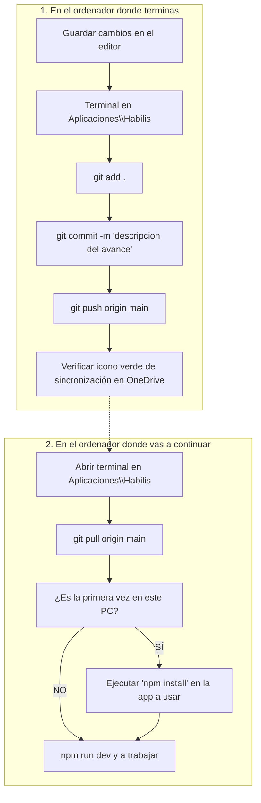

# 🧭 00 - Cuadro de Mandos y Protocolo Multi-Equipo HABILIS

> **Este documento es la brújula obligatoria para cualquier IA o desarrollador al iniciar una sesión de trabajo en cualquiera de los dos ordenadores.**

Última actualización: 16 de octubre de 2026.

---

## 💻 1. Entorno de Trabajo y los Dos Ordenadores

El proyecto Habilis se desarrolla y mantiene alternando entre dos ordenadores con la misma cuenta de OneDrive y GitHub:

| Característica | Equipo A (Sobremesa / Oficina) | Equipo B (Portátil de Movilidad) |
|---|---|---|
| **Rol habitual** | Equipo potente para diseño, modelos complejos y sesiones intensivas. | Equipo ligero y portátil para llevar a plantas, clientes o trabajo en movilidad. |
| **Capacidades** | Máxima potencia y rapidez de compilación. | Menos recursos; requiere comandos ligeros y no saturar memoria. |
| **Alcance** | Puede editar tanto **Fichajes** (`Gestión horaria/`) como la **App de Empresa** (`APP/`). | Debe poder editar y probar exactamente las mismas dos aplicaciones. |

---

## ⚙️ 2. ¿Por qué es necesario Node.js y qué debe estar instalado en ambos PC?

Para que ambos ordenadores puedan ejecutar y compilar las dos aplicaciones, ambos deben tener:

1. **Node.js (versión 18 o superior LTS):**  
   * **¿Para qué sirve?:** Es el motor fuera del navegador que traduce React 19 y TypeScript a HTML/JS comprensible, descarga las librerías (`npm install`), levanta los servidores locales de prueba (`npm run dev`) y genera las versiones de producción (`npm run build`).  
   * **En las tablets de planta:** Los trabajadores **NO** necesitan Node.js (solo abren el navegador web). Solo lo necesitan estos dos ordenadores de desarrollo.
2. **Git:**  
   * Para sincronizar el código limpio entre ambos ordenadores mediante GitHub sin sufrir los retrasos o conflictos de archivos bloqueados de OneDrive.
3. **Navegador Web Moderno (Chrome / Edge):** Para visualizar las aplicaciones en `localhost`.

---

## 🔄 3. Protocolo Infalible al Cambiar de Ordenador

Para no perder jamás una línea de código ni sobreescribir trabajo al pasar del sobremesa al portátil o viceversa, sigue siempre este ciclo:



> [!IMPORTANT]
> **Regla de oro de `node_modules`:**  
> La carpeta `node_modules` (que pesa cientos de megabytes con miles de archivos) **nunca viaja por Git ni debe sincronizarse por OneDrive** (está en `.gitignore`).  
> Si es la primera vez que abres una app en el portátil, o si en el otro ordenador se instaló una librería nueva, solo debes ejecutar:
> ```powershell
> npm install
> ```

---

## 📂 4. Mapa del Repositorio de Aplicaciones

Todo el código fuente y este contexto viven en la carpeta compartida:  
`OneDrive\Aplicaciones\Habilis\` (Repositorio Git: `habilis-logistica-pwa.git`)

```text
OneDrive\Aplicaciones\Habilis/
├── Contexto de trabajo/                     <-- ESTA CARPETA (Contexto compartido multi-equipo)
│   ├── 00_LEEME_PRIMERO_CONTROL_MANDOS.md   <-- Guía de sesión, ordenadores y protocolo
│   ├── 01_APLICACION_FICHAJES.md            <-- Estado técnico del módulo Gestión horaria
│   ├── 02_APLICACION_EMPRESA_OPERACIONES.md <-- Estado de la PWA corporativa principal
│   └── 03_PREGUNTAS_Y_TAREAS_PENDIENTES.md  <-- Tareas abiertas y preguntas para el usuario
│
├── Gestión horaria/                         <-- PWA TÁCTIL INDEPENDIENTE DE REGISTRO HORARIO
│   ├── src/components/                      <-- KioskView, SupervisorMonitor, AdminConfig
│   ├── src/services/                        <-- authPin (Salt+SHA-256), fichajeStorage, mockData
│   ├── src/types/                           <-- Tipos TypeScript
│   └── package.json                         <-- React 19 + TypeScript + Vite
│
├── APP/                                     <-- PWA CORPORATIVA INTEGRAL (Operaciones y Calidad)
│   ├── src/                                 <-- Checklists, fotos de muelles, portal del empleado
│   └── package.json                         <-- React 19 + TypeScript + Vite + jsPDF
│
└── .gitignore
```

---

## 🚦 5. Instrucciones Obligatorias para la IA que abra este proyecto

Cualquier IA (en el sobremesa o en el portátil) debe cumplir estrictamente estas 4 reglas:

1. **Lectura previa:** Antes de proponer o escribir código, lee este documento (`00_LEEME...`) y el archivo específico de la aplicación en la que se vaya a trabajar (`01_...` o `02_...`).
2. **Consultar antes de actuar:** Aplica siempre la regla del usuario:  
   > *"Antes de empezar a hacer algo pregúntame, quiero ir paso a paso firme y seguro."*
3. **Preguntas claras y directas:** En el primer mensaje, la IA debe confirmar que ha leído el contexto, resumir en qué punto estamos y formular la pregunta concreta sobre el siguiente paso a dar (ver `03_PREGUNTAS_Y_TAREAS_PENDIENTES.md`).
4. **Respeto a las limitaciones del equipo portátil:** Si se detecta que se trabaja en el portátil, evitar comandos pesados innecesarios y verificar siempre que las dependencias estén instaladas antes de compilar.
