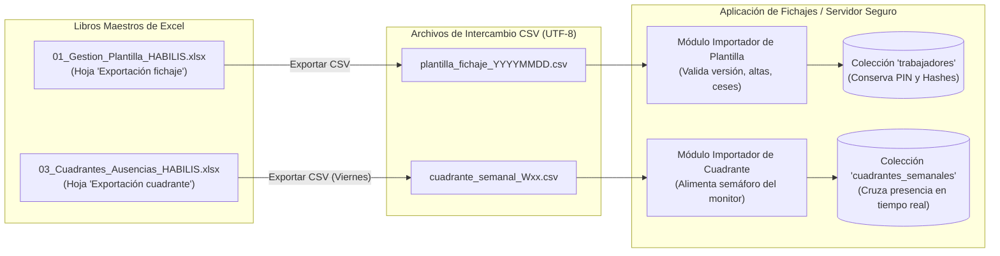

# Contexto de trabajo: Sistema de Registro Horario y Fichajes HABILIS

## Finalidad de este documento

Este archivo sintetiza las decisiones confirmadas, la arquitectura técnica y los flujos de seguridad del subsistema de **Registro Horario de HABILIS**. La especificación vigente de importación es [ESPECIFICACION_CSV_UNICO_LIBRO03.md](ESPECIFICACION_CSV_UNICO_LIBRO03.md); sustituye el diseño anterior de dos CSV que se conserva más abajo únicamente como antecedente histórico.

Este documento está alineado con la especificación maestra `CONTEXTO_APLICACION_FICHAJE_HABILIS.md`, `CONTEXTO_GESTION_PLANTILLA_HABILIS.md` y los procedimientos vigentes de recursos humanos (`POP-RRHH-001`, `IT-RRHH-001-02`, `FOR-RRHH-001-01`, `FOR-RRHH-001-02` y `FOR-RRHH-001-03`).

Última actualización: 3 de octubre de 2026.  
Estado del proyecto: PWA Standalone funcional (`Gestión horaria/`) con simulación de terminal Kiosk, control de acceso supervisor por candado, conmutación independiente de centros y autenticación criptográfica mediante PIN.

---

## 🎯 Objetivo General y Principios de Diseño

El sistema permite a cada persona trabajadora registrar personalmente su entrada y salida de la jornada laboral en los centros logísticos de Habilis (inicialmente Centro 1 y Centro 2 que prestan servicio a Saica Pack).

### Principios Fundamentales Confirmados:

1. **Identificación y Autenticación en Dos Pasos:**
   * **Identificación (Paso 1):** Número permanente de trabajador de **5 cifras** (`[Centro][Puesto][Correlativo]`), introducido mediante teclado numérico táctil en pantalla.
   * **Autenticación (Paso 2):** PIN personal numérico de **4 cifras** asignado y custodiado por el Gestor (entrada enmascarada con puntos de seguridad).
2. **Fichaje Presencial y Supervisado:**
   * El registro se realiza desde un dispositivo (tablet o terminal táctil Kiosk) custodiado en el acceso al centro de trabajo bajo la supervisión presencial del Responsable de Turno.
   * El trabajador teclea personalmente su número y su PIN. La pantalla muestra un saludo identificativo de confirmación (*"Hola, [Nombre Completo]"*) y la chapa de su puesto de trabajo antes de registrar la acción.
3. **Cumplimiento Estricto del RD-ley 8/2019 y RGPD (Minimización de Datos):**
   * **Hora inmutable de servidor:** La fecha y hora proceden exclusivamente del servidor central con sello oficial de tiempo (`serverTimestamp()`), impidiendo cualquier manipulación en el reloj local del dispositivo.
   * **Inmutabilidad:** Los registros originales no se sobrescriben ni se eliminan; cualquier corrección posterior deja trazabilidad de auditoría vinculada al parte físico de incidencias.
   * **Sin DNI/NIE:** Se excluye totalmente el DNI/NIE de la aplicación, de la base de datos y de las exportaciones. El código permanente de 5 cifras y el nombre completo identifican unívocamente a la persona trabajadora cumpliendo el principio de minimización del RGPD.
   * **Conservación legal:** Registros conservados durante 4 años, disponibles de forma inmediata para los trabajadores, la representación legal de los trabajadores y la Inspección de Trabajo y Seguridad Social.
4. **Arquitectura Independiente ("Standalone First"):**
   * Base de datos dedicada en la nube (Servidor seguro).
   * Total desacoplamiento de la aplicación corporativa principal, con posibilidad de integración futura mediante API o lectura compartida.
   * **Alimentación mediante un CSV:** El Libro 03 v2_3 recibe el personal del Libro 01 por Power Query y genera con un botón un único CSV semanal con toda la plantilla (activos y cesados) y los turnos planificados. La aplicación lo importa manualmente de una sola vez.
5. **Confidencialidad de la Infraestructura de Almacenamiento:**
   * En todas las interfaces públicas, pantallas para trabajadores, infografías, manuales de usuario y documentación operativa se utiliza exclusivamente la denominación neutral y abstracta: **"Servidor Seguro"**, **"Registro Inmutable en Servidor"** o **"Sello Oficial de Tiempo"**.
   * Bajo ningún concepto se divulga en interfaces o infografías el proveedor cloud comercial ni detalles internos de la base de datos.
6. **Identidad Corporativa Habilis:**
   * Toda la aplicación implementa la paleta y el imagotipo oficial de Habilis: tipografía corporativa roja acompañada de la medialuna azul en la cabecera y en el marco del terminal Kiosk.

---

## 🔢 Identificación de Trabajadores: Código Permanente de 5 Cifras

El número de trabajador es la clave primaria compartida entre el Excel maestro, la aplicación y la base de datos:

$$\mathbf{[Centro]} \; \mathbf{[Puesto]} \; \mathbf{[Correlativo]}$$

### 1. Desglose del Código:
* **1.ª Cifra (Centro de incorporación inicial):**
  * `1`: Centro 1 (Saica Pack · Velilla)
  * `2`: Centro 2 (Saica Pack · Meco)
* **2.ª Cifra (Puesto de incorporación inicial):**
  * `1`: Responsable
  * `2`: Carretillero
  * `3`: Operario
  * `4`: Administrativo
* **3 Últimas Cifras (Correlativo numérico):**
  * De `001` a `999` dentro de cada combinación de centro y puesto.

### 2. Rangos de Códigos Activos:
| Rango | Clasificación de Incorporación |
|---|---|
| `11001` – `11999` | Responsables del Centro 1 (Velilla) |
| `12001` – `12999` | Carretilleros del Centro 1 (Velilla) |
| `13001` – `13999` | Operarios del Centro 1 (Velilla) |
| `14001` – `14999` | Administrativos del Centro 1 (Velilla) |
| `21001` – `21999` | Responsables del Centro 2 (Meco) |
| `22001` – `22999` | Carretilleros del Centro 2 (Meco) |
| `23001` – `23999` | Operarios del Centro 2 (Meco) |
| `24001` – `24999` | Administrativos del Centro 2 (Meco) |

### 3. Reglas de Negocio del Código:
* Es **único y permanente**. No cambia jamás por ascenso, cambio de puesto o traslado de centro de trabajo.
* **No se reutiliza** tras un cese. En reincorporaciones futuras se reactiva exactamente el mismo número.
* La aplicación **no genera códigos**: los recibe exclusivamente de la base de datos importada desde el Excel maestro.
* Sirve como identificador de usuario, pero **nunca como contraseña o credencial de acceso**.

---

## 🔐 Credencial de Autenticación: PIN Personal de 4 Cifras

### 1. Generación y Custodia:
* Cada persona trabajadora dispone de un PIN numérico personal e intransferible de **4 cifras** (de `0000` a `9999`).
* **Administración y entrega:** Competencia exclusiva del perfil **Gestor** (`IT-RRHH-001-02` y formulario `FOR-RRHH-001-02`).
* **Total independencia:** No se deriva del DNI, fecha de nacimiento, número de trabajador ni teléfono.
* **No viaja en el Excel:** El Excel de plantilla jamás contiene los PINs ni columnas relacionadas con contraseñas. El PIN se genera y configura exclusivamente dentro del sistema de la aplicación.

### 2. Almacenamiento Criptográfico Seguro (Salt individual + SHA-256):
* **Nunca se almacena en texto plano.**
* **Salt Criptográfico Individual:** Dado que un PIN de 4 cifras posee solo 10.000 combinaciones posibles, el sistema genera para cada empleado una semilla aleatoria (*Salt*) criptográfica de 16 caracteres mediante el generador de números aleatorios criptográficos del sistema (`window.crypto.getRandomValues`).
* **Cálculo del Hash:** El sistema combina el PIN, el Salt único del trabajador y un secreto de sistema:
  $$\text{Hash} = \text{SHA-256}(\text{PIN} + \text{":"} + \text{Salt} + \text{":HABILIS\_SECURE\_CLOCK"})$$
* Dos trabajadores con el mismo PIN numérico generan hashes completamente distintos e irreversibles. En la base de datos solo se almacena el `pinHash` y el `pinSalt`.
* En el entorno de pruebas/prototipo, se incorpora un comodín de desarrollo (`1234`) para agilizar verificaciones sin deshabilitar la comprobación criptográfica real.

### 3. Política de Seguridad y Bloqueo (Límite estricto de 3 intentos):
* La pantalla enmascara los dígitos introducidos con puntos de seguridad.
* Si el trabajador comete un fallo, el sistema informa del error y de los intentos restantes (ej. *"PIN incorrecto. Te quedan 2 intentos"*).
* Al alcanzar **3 intentos fallidos consecutivos**:
  * El código del trabajador se **bloquea inmediatamente** en el sistema.
  * La pantalla emite una alerta neutra:  
    > *"⚠️ Límite de 3 intentos superado. Usuario bloqueado por seguridad. Avisa al Responsable para registrar la jornada en papel (FOR-RRHH-001-01)."*
  * Se genera un evento de auditoría.
  * El trabajador debe realizar sus fichajes de ese turno en papel mediante el formulario oficial **`FOR-RRHH-001-01`**.
  * El desbloqueo y asignación de un nuevo PIN requiere la intervención del Gestor/Responsable conforme al procedimiento `IT-RRHH-001-02` y la cumplimentación del parte **`FOR-RRHH-001-02`**.

---

## 🖥️ Arquitectura de la Aplicación y Modos de Pantalla

La aplicación está construida como una Progressive Web App (PWA) moderna con **React 19 + TypeScript + Vite** y Tailwind CSS.

### 1. Terminal Kiosk Táctil (`KioskView.tsx`)
Diseñada específicamente para su uso en tablets fijadas en pared o soportes de acceso.
* **Paso 1 - Identificación:** Teclado numérico en pantalla (botones de 72px optimizados para interacción táctil rápida con dedos o guantes). Chips de selección rápida en modo demo.
* **Paso 2 - Saludo y PIN:** Al teclear un código de 5 cifras válido, el sistema identifica al trabajador de inmediato:
  * Muestra una tarjeta destacada con su nombre completo, puesto y centro.
  * Muestra el teclado numérico para teclear el PIN de 4 cifras enmascarado.
* **Paso 3 - Registro Coherente:** Tras validar el PIN:
  * Si el trabajador no tiene jornada abierta: se habilita el botón verde **"Registrar Entrada"**.
  * Si ya tiene entrada registrada: se habilita el botón rojo **"Registrar Salida"**.
  * El sistema previene dobles entradas o salidas huérfanas.
  * Al confirmar, se muestra la pantalla de éxito con la hora oficial del servidor y una cuenta atrás visual de 3 segundos que reinicia el terminal automáticamente para el siguiente compañero.

### 2. Selector Independiente de Centro por Terminal
Cada centro logístico cuenta con sus propias tablets físicas.
* **Centros soportados:**
  * `1`: **Saica Pack · Velilla** (Centro 1 - Velilla de San Antonio).
  * `2`: **Saica Pack · Meco** (Centro 2 - Meco).
* **Independencia total entre dispositivos:** La asignación de la planta se almacena exclusivamente en el almacenamiento local del navegador (`localStorage.getItem('habilis_kiosk_centro')`). Cambiar de centro en la tablet de Velilla **no afecta en absoluto** a la tablet de Meco.
* **Conmutación rápida para Responsables:**
  * Al pulsar sobre la chapa del centro en la cabecera de la tablet, se abre un modal de cambio de centro.
  * El acceso de **Responsable** debe verificarse por `puestoActual === 'Responsable'` importado desde el Libro 01, además de la autenticación que corresponda. Los rangos `11xxx` / `21xxx` representan el puesto de incorporación, que podría haber cambiado, y no deben otorgar permisos por sí solos.
  * Al validar el código, se permite alternar entre Velilla y Meco al instante.
* **Trazabilidad en los fichajes:** Cada fichaje registrado en la base de datos se etiqueta automáticamente con el centro físico (`centroId`: 1 ó 2) y el identificador de terminal (`dispositivoId`: `TABLET-VELILLA` o `TABLET-MECO`).

### 3. Zona de Control de Responsables (`🔒 Zona Control`)
* **Acceso discreto:** El terminal Kiosk dispone de un botón con candado discreto en la esquina superior derecha (`🔒 Zona Control`).
* **Autenticación reforzada por categoría:**
  * Solicita código de 5 cifras y PIN de 4 cifras.
  * **Control de rol estricto:** El sistema verifica que el usuario autenticado tenga **`puestoActual = Responsable`** en la plantilla importada. Un código de incorporación de responsable no basta si la persona ya no ocupa ese puesto; un ascendido debe obtener el permiso sin cambiar su número permanente.
* **Monitor de Turno en Tiempo Real (`SupervisorMonitor.tsx`):**
  * Selector de turno activo: **☀️ Mañana** (06:00 - 14:00) / **🌇 Tarde** (14:00 - 22:00) / **🌙 Noche** (22:00 - 06:00).
  * Semáforo de presencia en planta:
    * 🟢 **Presentes (Verde):** Trabajadores del turno que ya han fichado su entrada (muestra hora exacta, puesto y centro).
    * 🔴 **Pendientes / Alerta retraso (Rojo):** Trabajadores previstos en cuadrante que aún no han fichado. Si el turno ya ha comenzado, calcula y destaca los minutos de demora (`⚠️ +15 min`).
    * 🔵 **Extras / Refuerzos (Azul):** Trabajadores que han fichado pero no estaban asignados a ese turno/centro.
  * **Botón de refresco activo:** Dispone de animación de giro (`RefreshCw`) y muestra en tiempo real la marca horaria exacta de la última actualización (`Actualizado: 17:35:42`), garantizando al responsable certeza absoluta sobre la frescura de los datos.

### 4. Simulador Kiosk Definitivo
* En la barra de navegación superior existe el botón `[👁️ Simular Pantalla Definitiva]`.
* Al activarlo, desaparece por completo la barra superior de desarrollo, mostrando la tablet a pantalla completa exactamente como la verán los trabajadores en planta.
* Para regresar al modo de administración o pruebas, incluye un botón flotante semitransparente en la esquina inferior: `[🛠️ Mostrar barra de desarrollo]`.

---

## 📑 Importación vigente desde el 2 de octubre de 2026

Se carga **un único CSV desde `Exportación app` del Libro 03 v2_3**. Incluye a toda la plantilla del Libro 01, estado `Activo`/`Cese` y las asignaciones diarias de la semana. El Libro 01 sigue siendo maestro de personal; el Libro 03 es maestro de turnos. La aplicación conserva PIN y fichajes y aplica ambos conjuntos de datos en una sola importación. El detalle de las 15 columnas, controles y avisos está en [ESPECIFICACION_CSV_UNICO_LIBRO03.md](ESPECIFICACION_CSV_UNICO_LIBRO03.md).

La aplicación debe ofrecer además una descarga de fichajes reales para el Libro 03 y, por separado, informes documentales de registros diarios y correcciones para trabajadores e Inspección. El contrato del retorno analítico está en [ESPECIFICACION_RETORNO_FICHAJES_APP_LIBRO03.md](ESPECIFICACION_RETORNO_FICHAJES_APP_LIBRO03.md). **Aún no está implementado ni validado en la aplicación.** Los datos de horas extras y compensación del Libro 03 son provisionales hasta confirmar convenio, calendario y correcciones.

Ante un cese, la pantalla compartida muestra un mensaje neutro y la zona autenticada del responsable muestra que la persona está cesada, no puede iniciar actividad y debe contactar con su superior. El CSV debe regenerarse e importarse inmediatamente cuando cambie un alta, cese o planificación durante la semana; no se espera al viernes.

### Diseño anterior de dos CSV: **NO VIGENTE**

Todo el contenido de esta subsección hasta «Modelo de datos» documenta una propuesta reemplazada. Se mantiene solo para entender la evolución del proyecto; no debe implementarse ni utilizarse para exportar archivos.

La siguiente propuesta describía los dos archivos separados de la versión anterior. **No es una especificación obligatoria ni debe implementarse.** El contrato aplicable es el CSV único enlazado arriba.



---

### 1. CSV de Plantilla: `Exportación fichaje` (Libro 01)

* **Libro de origen:** `01_Gestion_Plantilla_HABILIS_v2_1.xlsx`.
* **Hoja origen:** `Exportación fichaje`.
* **Frecuencia de exportación:** Cada vez que se produce un alta, un cese, una reincorporación o un cambio organizativo relevante.
* **Propósito:** Mantener la lista autorizada de personas trabajadoras que pueden fichar en los terminales táctiles.

#### Estructura de Columnas Requerida:

| N.º Columna | Nombre de Cabecera | Tipo de Dato | Obligatorio | Formato / Valores Permitidos | Descripción y Reglas de Negocio |
|---|---|---|---|---|---|
| **1** | `numeroTrabajador` | Texto (5 caracteres) | **SÍ** | `11001` a `24999` (5 dígitos exactos) | **Clave primaria**. Formato `[Centro][Puesto][Correlativo]`. En Excel debe formatearse como texto para no perder ceros. La app ignora filas con este campo vacío. |
| **2** | `nombreCompleto` | Texto | **SÍ** | Ej: `Carlos Gómez Martín` | Nombre y apellidos limpios sin espacios duplicados (`TRIM`). Es el texto que saluda al trabajador en la pantalla táctil. |
| **3** | `estadoLaboral` | Texto | **SÍ** | `Activo` \| `Cese` | Si está en `Activo`, permite configurar PIN y fichar. Si está en `Cese`, la app bloquea nuevos fichajes pero conserva todo su historial inalterado. |
| **4** | `fechaInicioAutorizacion` | Fecha (ISO o serial) | Opcional | `YYYY-MM-DD` (ej: `2026-10-01`) | Fecha de inicio de contrato o alta en Habilis. Determina a partir de qué fecha puede fichar. |
| **5** | `fechaCese` | Fecha (ISO o serial) | Opcional | `YYYY-MM-DD` o vacío | Vacío si el trabajador está en activo. Fecha de baja en caso de cese. |
| **6** | `centroActual` | Texto / Número | **SÍ** | `Centro 1` \| `Centro 2` (o `1` \| `2`) | Centro al que está asignado habitualmente el trabajador (`1` = Velilla, `2` = Meco). |
| **7** | `puesto` *(Recomendación)* | Texto | **SÍ** | `Responsable` \| `Carretillero` \| `Operario` \| `Administrativo` | **Campo crítico**. Debe tomarse de `Plantilla general!S5`. Permite reflejar ascensos de puesto sin cambiar el código de 5 cifras y otorga permisos de Responsable en la app. |
| **8** | `versionExportacion` | Texto | **SÍ** | Ej: `2026-0001` o `20261001-01` | Código correlativo de versión. La app comprueba que la versión que se importa sea superior a la actualmente cargada. |
| **9** | `fechaPreparacion` | Fecha / Hora | Opcional | `YYYY-MM-DD` o `YYYY-MM-DD HH:MM` | Fecha y hora de generación del lote para trazabilidad y auditoría. |

> [!IMPORTANT]
> **Recomendación para el diseño de la hoja en el Libro 01:**
> En la hoja `Exportación fichaje` actual del Libro 01 existen 8 columnas (`numeroTrabajador`, `nombreCompleto`, `estadoLaboral`, `fechaInicioAutorizacion`, `fechaCese`, `centroActual`, `versionExportacion`, `fechaPreparacion`). Se debe asegurar o añadir la columna `puesto` (vinculada a `Plantilla general!S5`). Si un archivo CSV no contiene la columna `puesto`, la aplicación deduce el puesto inicial a partir del 2.º dígito del código permanente, pero incluir la columna explícita garantiza la correcta gestión de ascensos.

---

### 2. CSV de Cuadrante Semanal: `Exportación cuadrante` (Libro 03)

* **Libro de origen:** `03_Cuadrantes_Ausencias_HABILIS_v2_1.xlsx`.
* **Hoja origen:** `Exportación cuadrante`.
* **Frecuencia de exportación:** Semanal (habitualmente los viernes para la semana siguiente, de lunes a domingo).
* **Propósito:** Alimentar el monitor de supervisión de la tablet para contrastar en tiempo real quién debe estar trabajando y detectar ausencias o retrasos.

#### Estructura de Columnas Requerida:

| N.º Columna | Nombre de Cabecera | Tipo de Dato | Obligatorio | Formato / Valores Permitidos | Descripción y Reglas de Negocio |
|---|---|---|---|---|---|
| **1** | `fecha` | Fecha (ISO) | **SÍ** | `YYYY-MM-DD` (ej: `2026-09-28`) | Fecha del día de trabajo asignado. |
| **2** | `numeroTrabajador` | Texto (5 caracteres) | **SÍ** | `11001` a `24999` (5 dígitos) | Código permanente. Clave de cruce con la plantilla de trabajadores. |
| **3** | `nombreCompleto` | Texto | Opcional | Ej: `Carlos Gómez Martín` | Nombre completo para verificación visual o informes rápidos. |
| **4** | `centro` | Texto / Número | **SÍ** | `Centro 1` \| `Centro 2` (o `1` \| `2`) | Centro logístico donde debe prestar servicio esa jornada. |
| **5** | `puesto` | Texto | **SÍ** | `Responsable` \| `Carretillero` \| `Operario` \| `Administrativo` | Puesto operativo asignado para esa jornada. |
| **6** | `turnoAsignado` | Texto (Mayúsculas) | **SÍ** | Catálogo oficial cerrado:<br/>• `MAÑANA`<br/>• `TARDE`<br/>• `NOCHE`<br/>• `DESCANSO`<br/>• `VACACIONES`<br/>• `BAJA`<br/>• `PERMISO` | Determina el semáforo del monitor de presencia en planta. Si un trabajador con turno `MAÑANA` no ficha antes de la hora de entrada, se marca en rojo con minutos de retraso. |
| **7** | `versionExportacion` | Texto | **SÍ** | Ej: `2026-W40-001` | Identificador de versión semanal de cuadrante (`Año-Semana-Lote`). |

---

### 3. Reglas Técnicas Comunes para la Exportación y Parseo de CSV

1. **Codificación:** Exclusivamente **`UTF-8`** (o `UTF-8 con BOM`). Es indispensable para preservar correctamente acentos, eñes y caracteres del español (`Gómez`, `Martín`, `Mañana`).
2. **Separador de Campos:**
   * El delimitador preferido en Microsoft Excel en español es el **punto y coma (`;`)**.
   * El importador de la aplicación implementa **autodetección inteligente de delimitador**: analiza la primera línea y acepta tanto punto y coma (`;`) como coma (`,`).
3. **Calificador de Texto:**
   * Si un campo de texto contiene espacios, comas o saltos de línea, debe ir encerrado entre comillas dobles (`"Carlos Gómez Martín"`).
4. **Filas de Metadatos y Detección de Cabecera:**
   * En los libros de Excel de Habilis, las primeras filas de las hojas de exportación contienen títulos informativos y casillas de versión (ej. filas 1 a 4).
   * El módulo de importación de la aplicación no asume una fila rígida: **escanea las primeras líneas hasta localizar la fila que contiene `numeroTrabajador`** (o `fecha`), identificándola como la cabecera oficial de la tabla.
5. **Filas Vacías:**
   * Las hojas de cálculo tienen rangos preparados para 100 o 996 filas. La aplicación ignora de forma limpia y transparente cualquier fila en la que el campo `numeroTrabajador` o `fecha` esté vacío.
6. **Idempotencia y Preservación de Seguridad:**
   * Cargar dos veces el mismo CSV no duplica trabajadores ni causa inconsistencias.
   * **Inviolabilidad de credenciales:** El importador actualiza nombres, puestos, centros y estados laborales, pero **jamás sobrescribe ni borra el `pinHash`, el `pinSalt` o los fichajes previos** de los trabajadores existentes.
   * Los trabajadores nuevos detectados en el CSV se crean automáticamente con `pinConfigurado = false`, quedando listos para que el Gestor les asigne su PIN en el terminal.

---

## 🗄️ Modelo de Datos en Base de Datos (Servidor Seguro)

### Colección: `trabajadores` (Alimentada vía CSV y gestión de PIN)
```typescript
interface Trabajador {
  numeroTrabajador: string;    // Clave primaria: "12001" (5 cifras exactas)
  nombreCompleto: string;       // "Carlos Gómez Martín"
  estado: 'ACTIVO' | 'CESE';    // 'ACTIVO' permite fichar; 'CESE' bloquea
  fechaInicioAutorizacion?: string | null; // ISO; no fichar antes de esta fecha
  fechaCese?: string | null;    // ISO para cesados
  centroActual: 1 | 2;          // 1: Saica Pack Velilla, 2: Saica Pack Meco
  puesto: 'Responsable' | 'Carretillero' | 'Operario' | 'Administrativo';
  pinHash: string;              // Hash seguro SHA-256 (PIN + Salt + Secreto)
  pinSalt: string;              // Semilla criptográfica aleatoria de 16 caracteres
  pinConfigurado: boolean;      // true si ya tiene credencial asignada
  intentosFallidos: number;     // 0, 1, 2 (bloquea a los 3)
  bloqueado: boolean;           // true si ha superado los 3 intentos
  versionImportacion?: string;  // ej: "2026-0001"
  fechaActualizacion?: string;  // Timestamp de última actualización
}
```

### Colección: `cuadrantes_semanales` (Alimentada desde el CSV único del Libro 03)
```typescript
interface PlanTurnoTrabajador {
  id?: string;                  // "2026-09-28_12001"
  fecha: string;                // "2026-09-28" (Formato ISO)
  numeroTrabajador: string;     // "12001"
  nombreCompleto: string;
  centroPlanificado: 1 | 2 | null;
  puestoPlanificado: 'Responsable' | 'Carretillero' | 'Operario' | 'Administrativo' | null;
  turnoAsignado: 'MAÑANA' | 'TARDE' | 'NOCHE' | 'DESCANSO' | 'VACACIONES' | 'BAJA' | 'PERMISO' | 'REFUERZO' | 'DESCANSO_COMPENSATORIO' | null;
  horaInicioPlanificada?: string | null; // HH:mm; hora prevista, no fichaje real
  horaFinPlanificada?: string | null;
  versionExportacion: string;   // "2026-W40-001"
}
```

### Colección: `fichajes` (Registros Inmutables con Sello Oficial de Tiempo)
```typescript
interface Fichaje {
  id: string;                   // Identificador único inmutable generado por el servidor
  numeroTrabajador: string;     // "12001"
  nombreCompleto: string;
  centroId: 1 | 2;              // 1: Velilla, 2: Meco
  tipo: 'ENTRADA' | 'SALIDA';
  timestamp: string;            // Sello oficial de tiempo del servidor (ISO / serverTimestamp)
  fechaStr: string;             // "2026-09-29"
  horaStr: string;              // "05:58:24"
  dispositivoId: string;        // "TABLET-VELILLA" | "TABLET-MECO"
  estado: 'VALIDO' | 'CORREGIDO' | 'ANULADO';
  correccion?: {
    fechaCorreccion: string;
    gestorId: string;
    motivo: string;
    numeroPartePapel?: string;  // Referencia a FOR-RRHH-001-01 (ej. "FOR-RRHH-001-01 / N.º 042")
  };
}
```

### Colección: `auditoria` (Trazabilidad y Seguridad)
```typescript
interface LogAuditoria {
  id: string;
  timestamp: any;               // serverTimestamp
  usuarioGestor: string;        // Código del responsable que ejecuta la acción
  accion: 'IMPORTACION_CSV_PLANTILLA' | 'IMPORTACION_CSV_CUADRANTE' | 'ASIGNACION_PIN' | 'RESTABLECIMIENTO_PIN' | 'CORRECCION_FICHAJE' | 'CAMBIO_CENTRO_TERMINAL';
  detalle: string;              // Detalle operativo (sin guardar PINs ni datos sensibles)
}
```

---

## 📝 Procedimientos en Papel y Gestión de Contingencias

Para caídas de red eléctrica, fallos de cobertura, olvidos puntuales o bloqueos de PIN, la base de datos digital no se manipula directamente sin respaldo documental. Se aplican los formularios aprobados:

1. **`FOR-RRHH-001-01` (Registro manual y corrección de jornada):**  
   Parte individual en papel donde se consigna fecha, horas reales de entrada/salida, motivo de la incidencia y firmas autógrafas del trabajador y del responsable. Este documento es el justificante obligatorio para que el Gestor introduzca una corrección trazable en el sistema.
2. **`FOR-RRHH-001-02` (Asignación y entrega de PIN):**  
   Constancia documental de entrega o restablecimiento de credenciales, firmado por el trabajador sin anotar el valor numérico del PIN.
3. **`FOR-RRHH-001-03` (Registro colectivo por indisponibilidad técnica general):**  
   Hoja de firmas colectiva utilizada en caso de corte eléctrico o fallo generalizado del terminal en planta.
4. **Custodia legal:**  
   Los partes físicos originales se archivan y custodian físicamente durante un periodo mínimo de **4 años**.

---

## 🚀 Próximos Pasos de Desarrollo Confirmados

Siguiendo el principio de trabajo *"paso a paso firme y seguro"*, las siguientes fases son:

1. **Conexión de Base de Datos Dedicada:**
   * Creación y enlace de la nueva base de datos dedicada para el registro horario.
   * Reglas de seguridad estrictas (lectura/escritura autenticada, inmutabilidad de fichajes).
2. **Módulo de Importación CSV en la Aplicación (`AdminConfig.tsx`):**
   * Selector visual de un solo archivo generado desde `Exportación app` del Libro 03.
   * Previsualización de semana, versión, altas, modificaciones, ceses y turnos; rechazo completo si hay errores.
   * Actualización conjunta de trabajadores y planificación, conservando PIN, fichajes y auditoría existentes.
   * Aviso restringido al responsable cuando un código corresponda a una persona cesada.
3. **Módulo de Reportes Oficiales y Exportación:**
   * Generación de hoja de control mensual para trabajadores (cumplimiento RD-ley 8/2019, sin DNI).
   * Generación de reporte oficial para la Inspección de Trabajo.
   * Exportación de incidencias y horas para conciliación con el Libro 03 de Excel.
